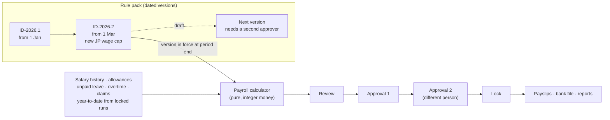

# Roster

An HR system for growing companies: employee records, geofenced clock-in, leave with approvals, and a payroll engine driven by dated rule packs (Indonesia PPh 21 and BPJS built in, plus a generic progressive pack). Employees get an installable phone app in English and Bahasa Indonesia.

**[Watch the 90-second walkthrough](docs/demo.mp4)** · [Case study](docs/CASE-STUDY.md)

| | |
|---|---|
|  |  |
|  |  |

<p>  </p>

## Features

**People**
- Several companies in one install, fully isolated. Roles are set per company, and two-factor sign-in is required for anyone who can see salaries.
- Employee profiles with effective-dated salary history, encrypted ID numbers (each reveal is logged), documents, org chart and spreadsheet import.
- Audit log of every change to people, pay and rules.

**Time**
- Clock-in from the phone, checked against the office geofence on the server clock. Night shifts are supported.
- Leave counts working days only. Allowances are prorated with a waiting period, half days are allowed, and requests split across years.
- One approval flow for leave, overtime, attendance corrections, bank account changes and expense claims. It routes to the manager, to the manager's manager when they are on leave, or to an HR queue, with an optional second HR approval.
- Attendance board, leave calendar, and HR settings for work patterns and leave types.

**Pay**
- **Payroll engine.** PPh 21 by monthly TER with the year-end Article 17 recalculation (including refunds for people who leave mid-year). Also covers BPJS with wage caps, overtime at 1/173, THR, unpaid leave and expense reimbursements.
- **Rule packs.** Rates live in dated versions. Each changed number needs a source and a second approver, and a new version can never change a locked month.
- **Payroll runs.**
  - Calculate, then review: changes above 20% need a tick, and negative net pay blocks approval.
  - Two different people approve, then the run is locked and payslips go out (in the app and as a PDF), along with the bank transfer file.
- **Reports.** Payroll and contribution reports that always add up to the payslips, with Excel and CSV export.

**Employee app**
- Installable to the home screen, with push notifications. English and Bahasa Indonesia.
- Clock-in, time off, attendance corrections, overtime, expense claims with receipt photos, payslips and profile.
- **Ask HR** answers questions from the company's policies and the person's own data, with numbered sources.

## How payroll stays correct



Locked payroll items keep their own copy of every number and the rule pack version, so later salary or rate changes never alter a paid month.

## Tech stack

Laravel 12 (PHP 8.5) · PostgreSQL 17 · Inertia + Vue 3 (TypeScript) · Pest · Playwright · Groq (OpenAI-compatible API) for Ask HR.

## Getting started

```bash
composer install && npm install
cp .env.example .env && php artisan key:generate
# set DB_* (PostgreSQL) in .env, then:
php artisan migrate --seed
npm run build && php artisan serve
```

Demo accounts (password `password`). Roles that see salaries set up two-factor with any authenticator app on first sign-in.

| Account | Role |
|---|---|
| `hr@roster.test` | HR admin |
| `payroll@roster.test` | Payroll officer |
| `manager@roster.test` | Manager |
| `employee@roster.test` | Employee (phone app) |
| `auditor@roster.test` | Auditor |
| `super@roster.test` | Super admin, two companies |

**Optional configuration**

| Variable | Purpose |
|---|---|
| `GROQ_API_KEY` | Lets Ask HR and the payroll briefing write answers. Without it they show the matching policy passages. |
| `GROQ_MODEL` | Groq model, `openai/gpt-oss-120b` by default. |
| `VAPID_PUBLIC_KEY`, `VAPID_PRIVATE_KEY` | Web push. Generate with `php artisan webpush:vapid`. |

## Tests

```bash
./vendor/bin/pest            # unit and feature tests (PostgreSQL)
npm run e2e                  # Playwright, on its own database and port
./vendor/bin/phpstan analyse
```

The payroll calculator has hand-worked golden cases for Indonesia (TER, year-end recalculation, refunds, BPJS caps, overtime, THR) and the generic pack.

## Notes

- All people, salaries, companies and policies in the demo data are fictional.
- Indonesian rates come from the cited regulations. Each number in the rule pack shows its source and the date it was checked. Verify them before running real payroll.
