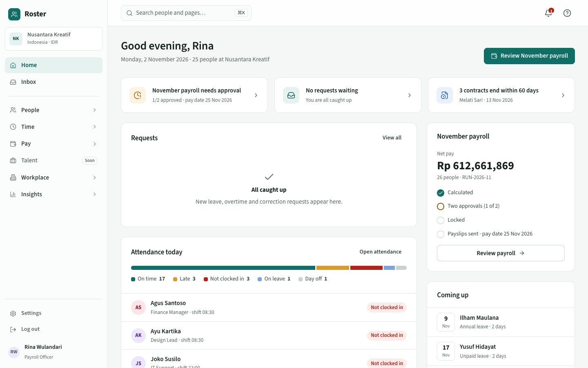
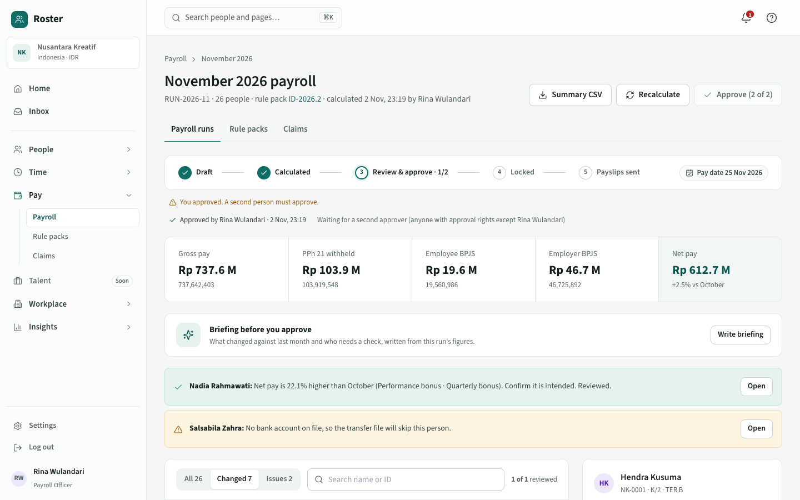
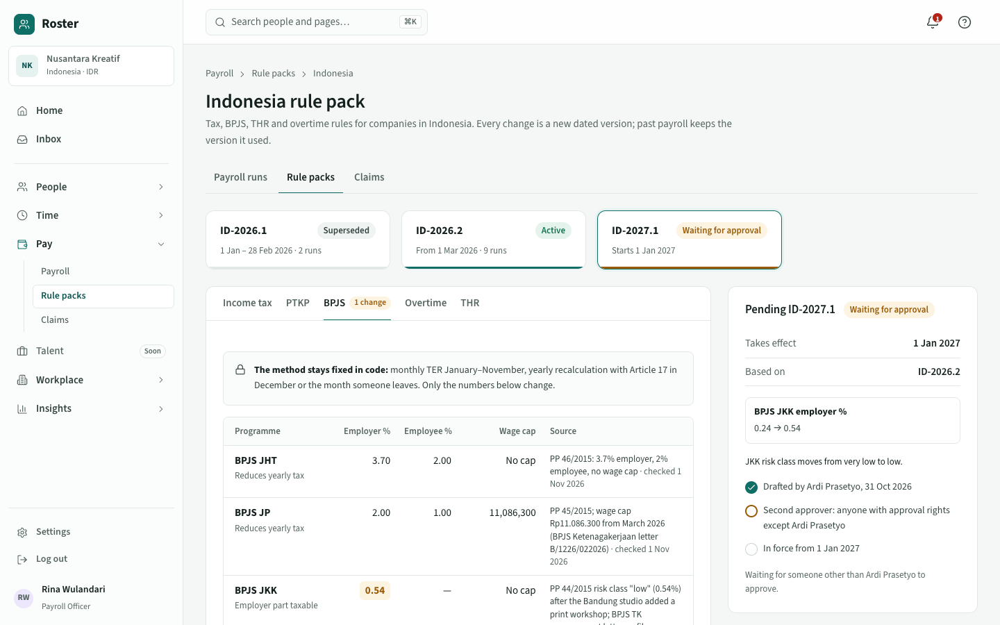
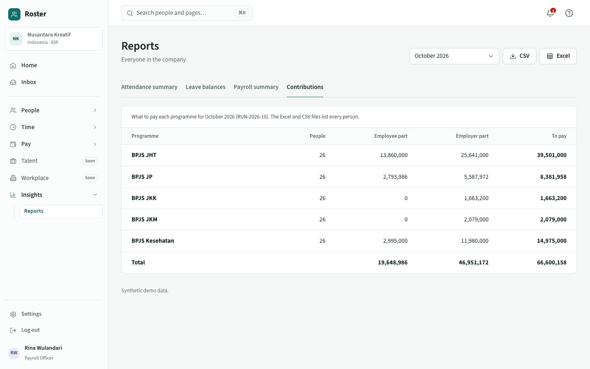
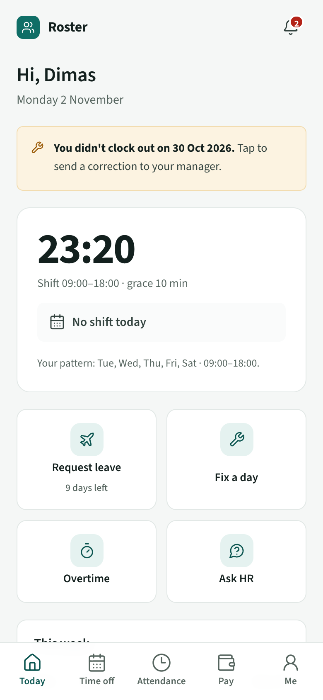
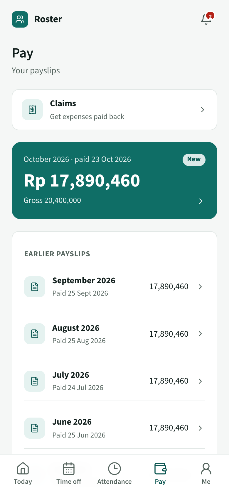
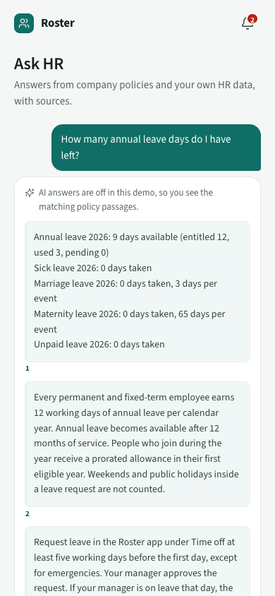
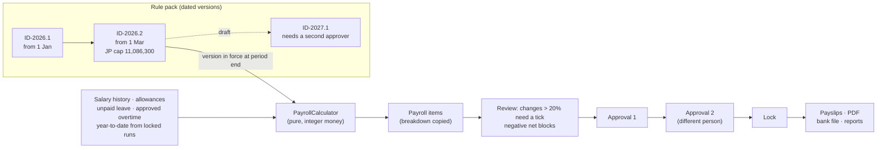

# Roster — multi-country HRIS

People records, attendance with geofenced clock-in, leave with approvals, and a rule-pack payroll engine (Indonesia + a generic progressive pack), with an installable phone app for employees in English and Bahasa Indonesia.

Laravel 12 · PostgreSQL · Inertia + Vue 3 (TypeScript) · Pest · Playwright. Product, design and plan: [BREAKDOWN.md](BREAKDOWN.md), [docs/](docs/), [DESIGN.md](DESIGN.md).

| | |
|---|---|
|  |  |
|  |  |

<p>  </p>

**Video walkthrough:** [docs/demo.mp4](docs/demo.mp4) (about 90 seconds) · **Case study:** [docs/CASE-STUDY.md](docs/CASE-STUDY.md)

## How payroll stays correct



Locked items keep their own copy of every number and the version code, so later salary or rate changes never alter a paid month. Corrections go into the next run.

## Milestone 1 (built)
- **Multi-company isolation**: every company-owned model uses `BelongsToCompany` (global scope + auto-fill). The active company is resolved per request by `SetCurrentCompany` after verifying membership. Records of another company resolve to **404**.
- **Roles per company**: spatie/laravel-permission with teams keyed by `company_id`. Roles: Super Admin, HR Admin, Payroll Officer, Manager, Employee, Auditor (`app/Enums/Role.php`). Access decisions in `EmployeePolicy`.
- **Two-factor (TOTP)** is mandatory for roles that can see salaries or identifiers, with 8 single-use recovery codes and one challenge per session.
- **Personal identifiers** (NIK, NPWP, BPJS, NI) are encrypted at rest; only the last four digits are stored in clear. Revealing a full number is permission-checked, rate-limited and written to the audit log.
- **Audit log** (owen-it/laravel-auditing, with `company_id`) for employees, identifiers and salary history; personal data and identifier values never enter the log.
- **Effective-dated salary history**: changes append rows; the current row is the latest on or before today, future rows show as "Scheduled".
- **Org chart**: reporting lines from each profile's manager, collapsible, department highlight; managers see only their subtree.
- **Spreadsheet import** (CSV/XLSX, up to 1,000 rows): every row is validated against the company first (duplicates, dates, managers, locations, salaries) and the import is blocked until all rows pass; managers listed later in the file are linked after insert.
- **Documents**: PDF/JPG/PNG on the private disk, optional expiry, served only through a permission check, audited.
- **Screens**: directory, org chart, import preview, employee profile (overview, job & pay, documents, activity), 2FA and password pages, all on custom components (no native selects or date pickers).

## Milestone 2 (built): attendance, leave, approvals
- **Clock-in/out** (phone-first `/me/today`): the server clock in the company time zone, never the device's. A haversine geofence checks the office radius, with remote work allowed only when the location says so. Clock-in opens 2 hours before the shift and closes when it ends. Late minutes are counted after the grace period.
- **Work patterns**, including night shifts that cross midnight: a 22:00–06:00 shift belongs to the date it started. Public holidays are kept per country.
- **Missing clock-outs**: `attendance:close-incomplete` runs hourly and flags them. The employee fixes one by sending a correction; the original times are kept.
- **Leave**:
  - Counts working days only, using the person's pattern and the holidays.
  - Splits a request across years.
  - Supports upfront or monthly accrual, prorated for joiners, with a service waiting period.
  - Allows half days and stops overlapping requests.
  - Event-based types (marriage, maternity) are granted per event.
  - Cancelling leave already in progress gives back only the days not yet taken.
- **Approval engine** (leave, overtime, corrections):
  - Goes to the direct manager.
  - If the manager is on leave that day, goes to their manager.
  - With no manager, goes to the HR queue.
  - Some leave types need a second HR approval.
  - Nobody approves their own request.
  - Rejecting requires a comment.
- **Screens**:
  - Employee app: Today, Time off, My attendance.
  - Inbox, showing balance-after and who else is off.
  - Daily attendance board.
  - Monthly leave calendar.
  - **Reports**: monthly attendance summary and yearly leave balances, with CSV export protected against formula injection.
- Managers see their direct reports; HR sees the whole company.

## Milestone 3 (built): payroll engine, rule packs, payslips
- **Pure calculator** (`app/Payroll`): integer money, no database or clock. Golden tests worked out by hand: 14 Indonesia, 5 Generic.
  - **Earnings:** prorated base (calendar or working days, split when the salary changes mid-month), fixed and non-fixed allowances, unpaid leave, overtime at 1/173 with workday and rest-day multipliers, THR (pro rata under 12 months), one-off pay and deductions.
  - **Contributions:** BPJS on base + fixed allowances, with wage caps (JP, Kesehatan).
  - **Indonesia tax:** PPh 21 by monthly TER (PP 58/2023) January–November. December, or the month someone leaves, recalculates the year with Article 17 and withholds the difference; a negative difference is refunded.
  - **Generic pack:** illustrative progressive bands for companies without a country pack.
- **Rule packs:** dated versions, never deleted; the version used is the latest approved one in force at the period end.
  - Drafts change numbers only. The method and TER tables stay fixed.
  - Every changed number needs an updated source, and someone other than the author approves.
  - A version starts on the 1st of a month and never inside a locked period.
- **Payroll runs:** draft → calculate (queued, with progress) → review → two different approvers → lock → send payslips.
  - Net pay moving more than 20% needs a reviewer's tick; negative net pay blocks approval.
  - Locked numbers are copies, so later salary or rate changes never alter them.
  - Months run in order, one open run at a time.
- **Outputs:** payslips in the employee app plus a PDF. A bank transfer CSV for locked runs only, with the export written to the audit log. A summary CSV with every contribution.
- **Sources:** each number in `database/data/rule-packs/*.php` carries its source and check date. The BPJS Kesehatan cap for 2026 is marked "verify".

## Milestone 4 (built): self-service, notifications, reports, polish
- **Home** per role: payroll status, requests with one-click approve, today's attendance ("shift later" before a shift starts), contracts ending, upcoming holidays, leave and rule pack changes, headcount. Managers see their team only.
- **Notifications**: in-app bell, email, and web push (VAPID) for approvals, decisions and published payslips. Notifications for steps someone else already decided are marked read automatically.
- **Employee app**:
  - Installable (manifest, icons, hand-written service worker).
  - The offline page appears without a connection; clock-ins are never stored on the phone.
  - Profile with phone, language and push settings.
  - Bank account changes go to the HR queue and apply only after approval.
- **Languages**: the employee app, server messages, emails and payslip PDFs follow each person's language (English / Bahasa Indonesia). The admin workspace stays in English.
- **Reports**:
  - Attendance and leave balances.
  - Payroll by department and contributions per programme, read from locked runs so totals equal the payslips (tested).
  - CSV or Excel export, protected against formula injection.
- **Audit log** for auditors and super admins: filter by date, person, area and event; encrypted values show only that they changed.
- **Time settings** for HR: work patterns (overnight shifts, working days, grace, default) and leave types (allowance, accrual, eligibility, per-event, half days, HR second approval).
- **Search**: Cmd/Ctrl+K finds people within the viewer's scope, and pages.

## Milestone 5 (built): Ask HR, payroll briefing, expense claims
- **Ask HR** (employee app): questions about leave, attendance, overtime and pay.
  - Answers come only from the company's policies and the asker's own HR data (built on the server for that person), with numbered sources.
  - With `ANTHROPIC_API_KEY` set, Claude Opus 5.5 writes a short cited answer, with server-side refusal fallbacks. Without a key, or if the call fails, the closest policy passages are shown and labelled.
- **Policies**: HR adds them as text or `.md`/`.txt` files. They are split into passages by heading and searched with PostgreSQL full-text search, scoped to the company. 20 questions with known sources are tested.
- **Payroll briefing**: before approving, payroll gets a short read of what changed against last month and who needs a check, written from the run's own figures. It is generated by Claude when configured, by rules otherwise.
- **Expense claims**: employees claim from the phone with a receipt photo.
  - Monthly limits per category, approval by the manager.
  - Approved claims are paid untaxed in the next payroll run and marked paid when it locks.
- **Not done**: a public hosted demo. It needs a server with PHP 8.5 and PostgreSQL; the [video](docs/demo.mp4) shows the full product instead.

## Run locally
```bash
composer install && npm install
cp .env.example .env && php artisan key:generate
# set DB_* in .env (PostgreSQL), then:
php artisan migrate --seed
npm run build && php artisan serve
```
Demo logins (password `password`): `hr@roster.test` and `payroll@roster.test` (both approve payroll; scan the 2FA QR code with any authenticator app on first sign-in), `manager@roster.test`, `employee@roster.test`, `auditor@roster.test`, `payroll@roster.test`, `super@roster.test` (two companies), `uk.hr@roster.test`.

## Checks
```bash
./vendor/bin/pest          # unit + feature tests on PostgreSQL (roster_test)
npm run e2e                # Playwright on its own database (roster_e2e) and port 8030
./vendor/bin/phpstan analyse
./vendor/bin/pint --test
npx vue-tsc --noEmit
```

All names, IDs and salaries in the seed are synthetic.
